One wall, three positions. That frame became the title of the issue before we had even named it: three forces, one direction.

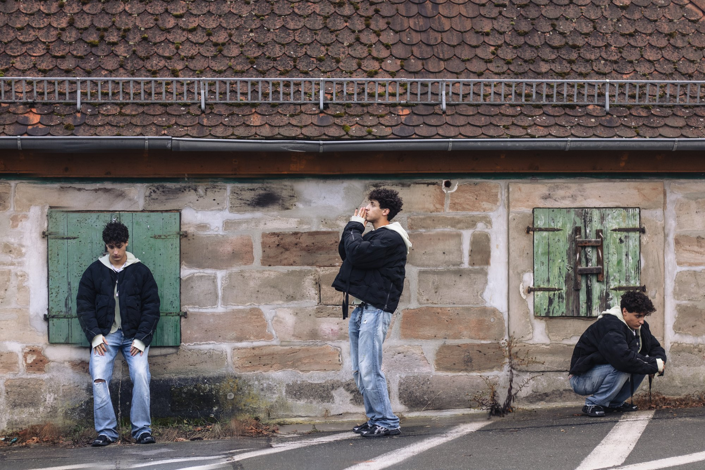

## Forest

Late light, wet ground, boots that have walked further than we have. Nothing here was bought for the shoot — it is what we wear.

:::gallery
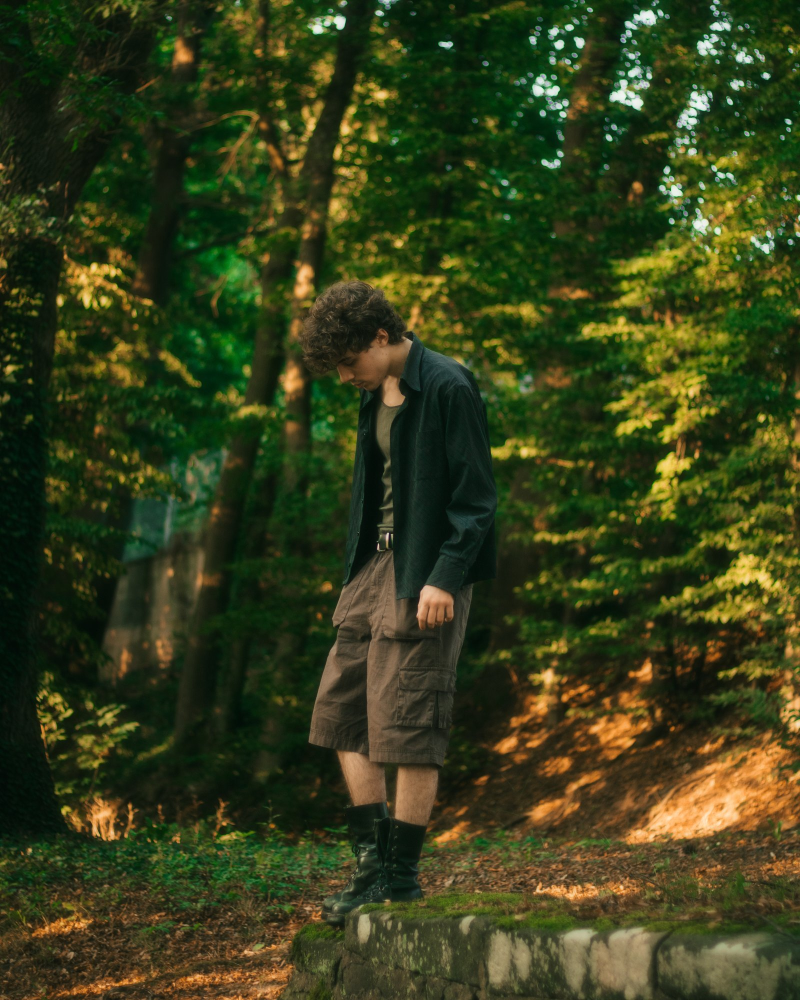
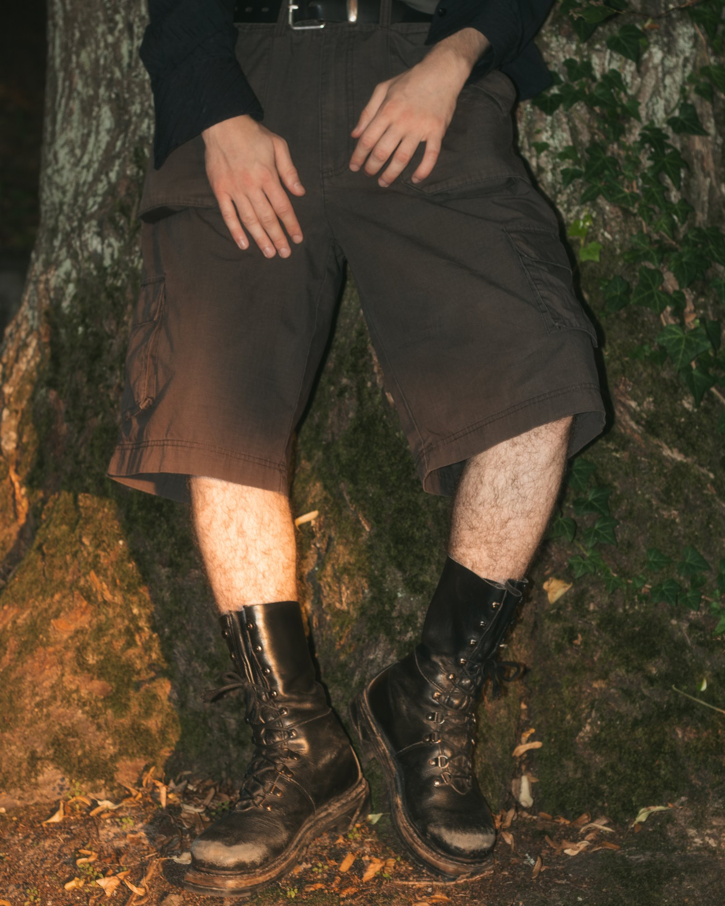
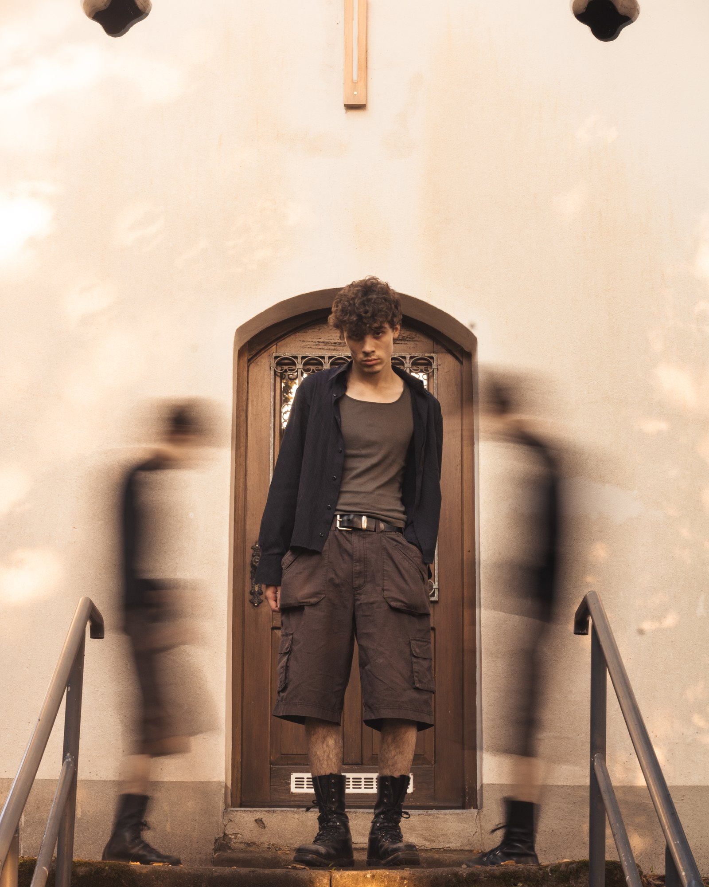
:::

## Stone & street

Corrugated metal, sandstone, a red wall nobody repainted. The city as a backdrop that doesn't ask for attention.

:::gallery
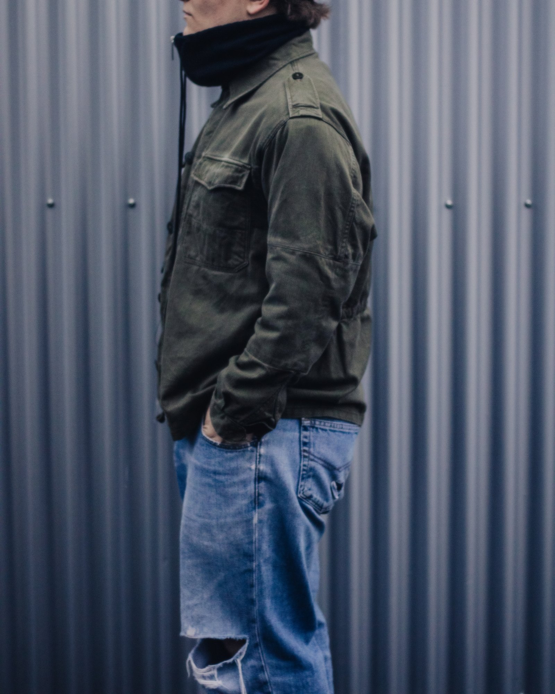
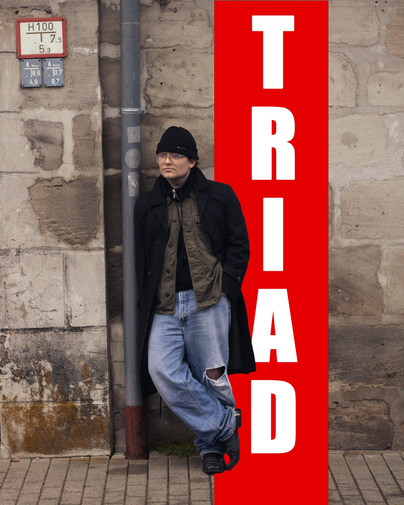
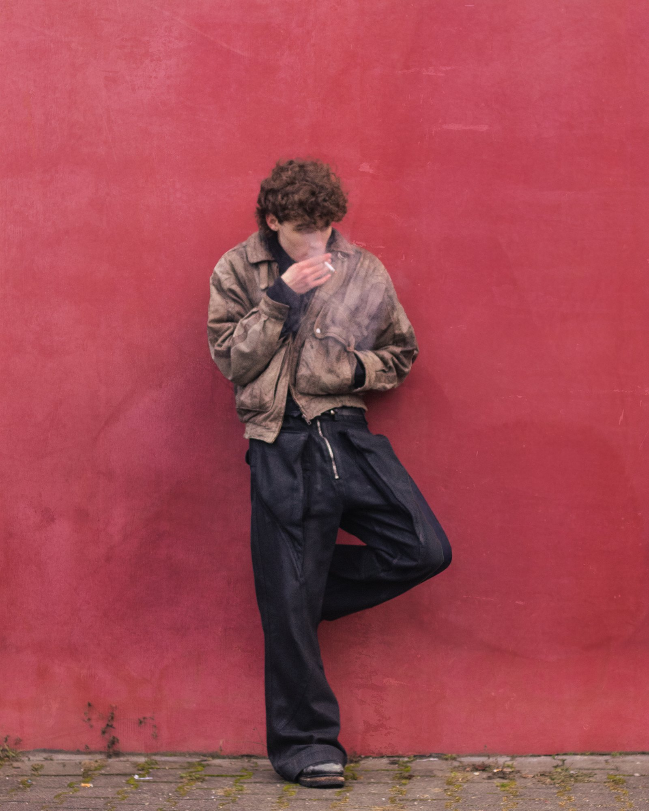
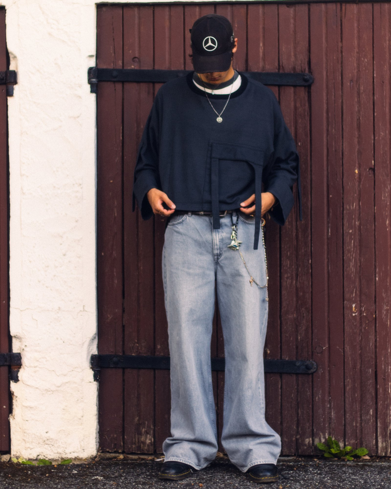
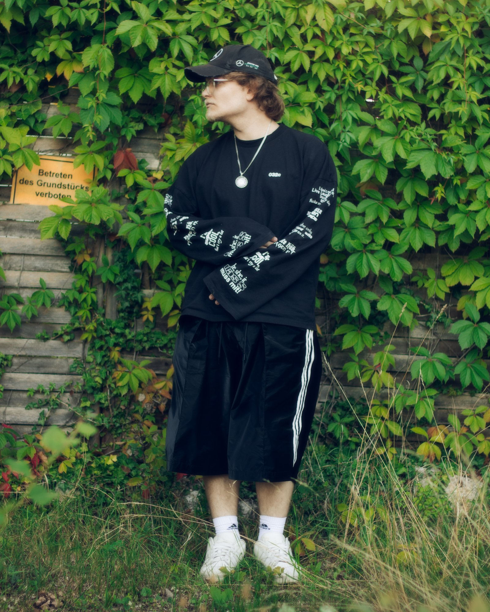
:::

## North

Iceland: black sand, snow, a waterfall loud enough to end every conversation. The pixel hand — three fingers up — followed us there.

:::gallery
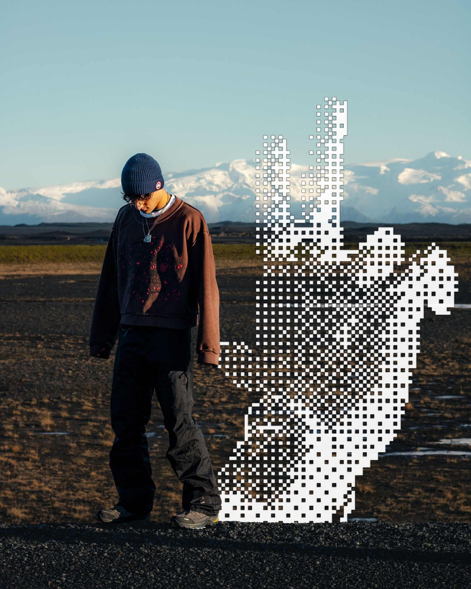
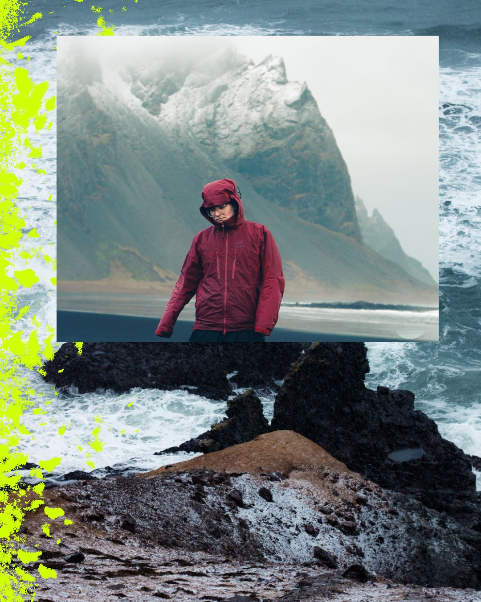
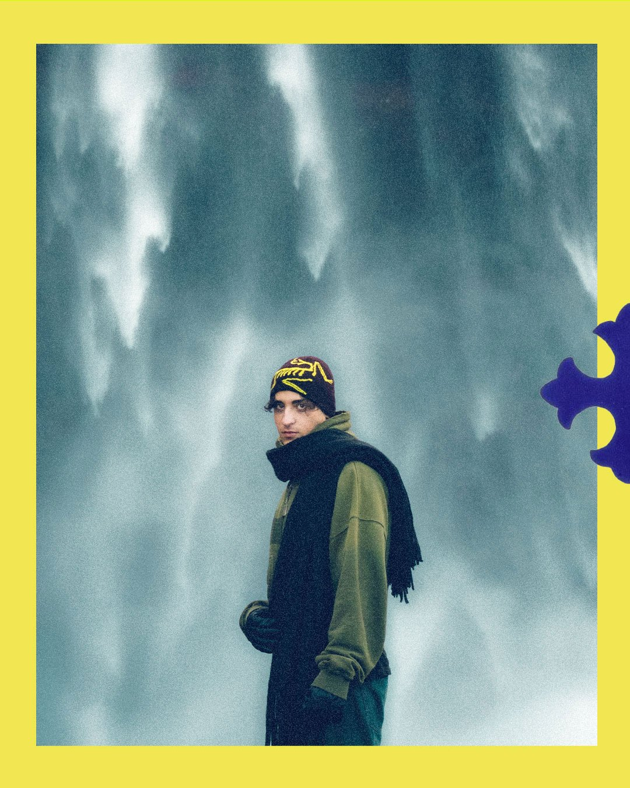
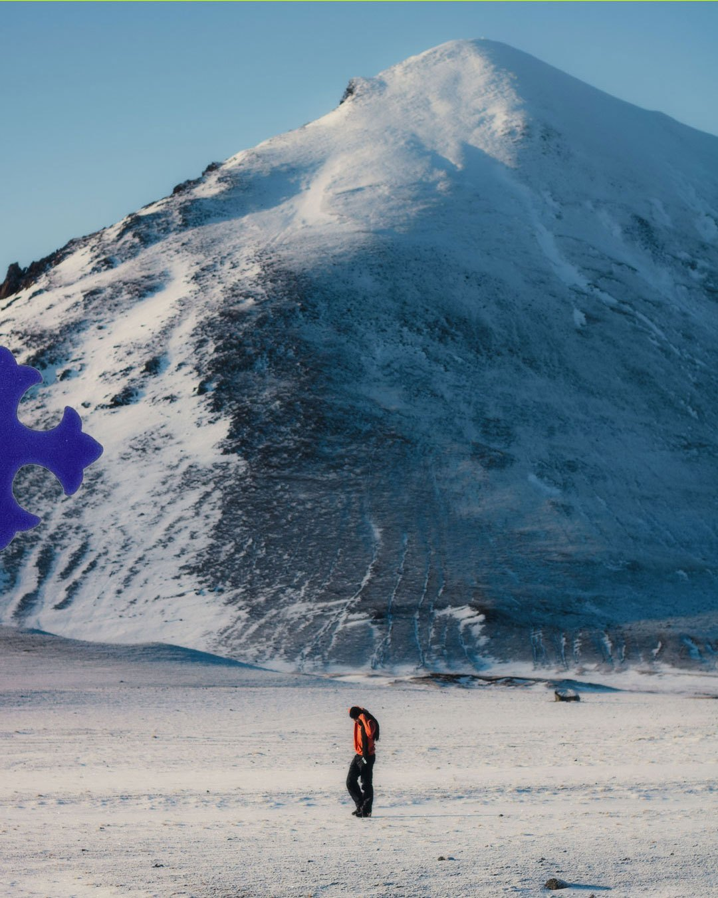
:::
